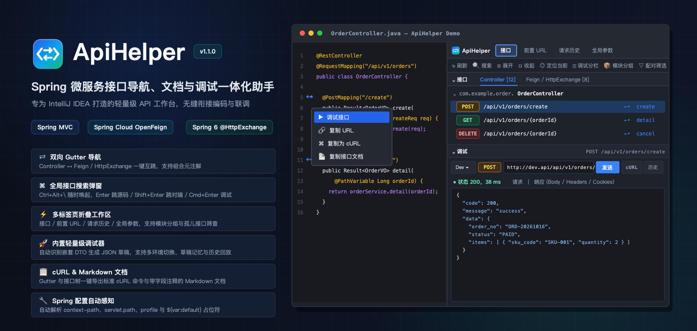
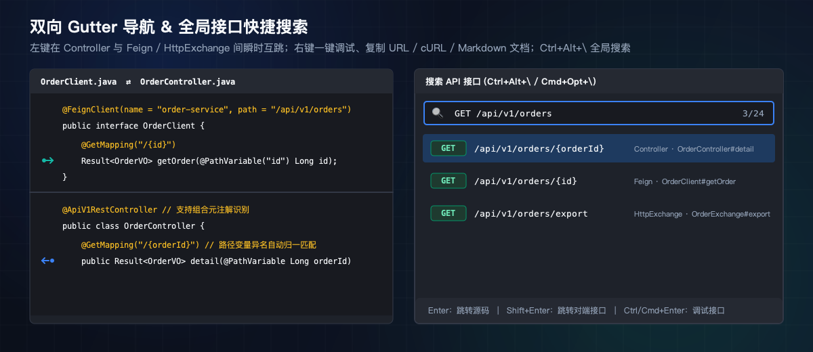
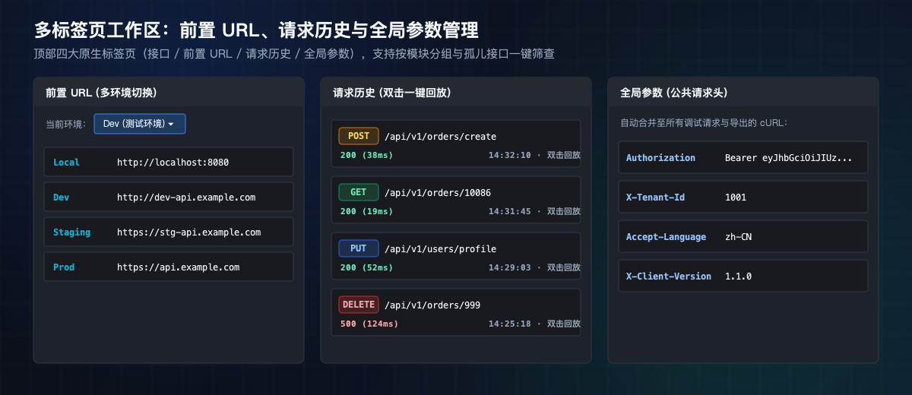
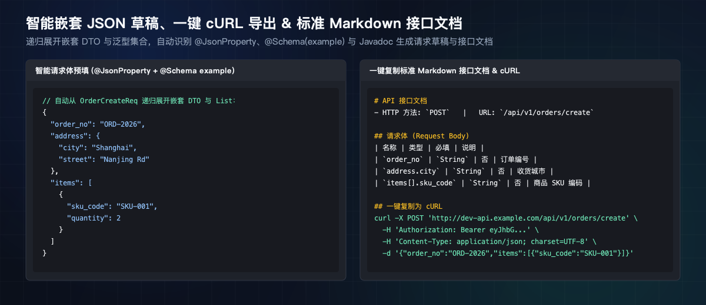

<p align="center">
  
</p>

<p align="center">
  <a href="https://plugins.jetbrains.com/plugin/32327-apihelper"></a>
  <a href="https://plugins.jetbrains.com/plugin/32327-apihelper"></a>
  <a href="https://github.com/sxhjlzl/api-helper/blob/main/LICENSE"></a>
  <a href="https://github.com/sxhjlzl/api-helper/stargazers"></a>
</p>

<p align="center">
  <a href="https://plugins.jetbrains.com/plugin/32327-apihelper">JetBrains 插件市场</a>
  ·
  <a href="./CHANGELOG.md">更新日志</a>
  ·
  <a href="https://github.com/sxhjlzl/api-helper/issues">问题反馈</a>
  ·
  <a href="./README_en.md">English</a>
</p>

---

**ApiHelper** 是一款面向 **Spring MVC Controller**、**Spring Cloud OpenFeign** 与 **Spring 6 `@HttpExchange`** 的 IntelliJ IDEA 插件，将**双向源码导航**、**全局接口检索**、**多环境轻量 API 调试**、**cURL 导出**与 **Markdown 接口文档生成**无缝收敛到 IDE 内，减少在代码编辑器、配置文件、外部文档与接口调试工具之间的频繁切换。

## 核心亮点

### 1. 双向 Gutter 导航与全局快捷搜索

<p align="center">
  
</p>

- **Controller ↔ Feign / HttpExchange 双向跳转**：左键点击方法旁的 Gutter 图标即可跳转到对端实现或声明（多目标时弹出选择列表）；容忍两端路径变量命名差异（如 `{id}` 与 `{orderId}`），并支持识别自定义 Spring 组合元注解（如 `@ApiV1RestController`）。
- **Controller Gutter 快捷菜单**：右键点击 Controller 方法旁的 Gutter 图标，无需打开工具窗口即可直接执行 **调试接口**、**复制 URL**、**复制为 cURL**、**复制接口文档**。
- **全局接口搜索弹窗（`Ctrl+Alt+\` / `Cmd+Opt+\`）**：在任意位置通过 `Navigate → 搜索 API 接口...` 或快捷键唤起全局检索弹窗：
  - `Enter`：直接跳转到接口源码
  - `Shift + Enter`：直接跳转到对端接口
  - `Ctrl / Cmd + Enter`：直接在调试面板中打开该接口

### 2. 多标签页与可折叠分栏工作区

<p align="center">
  
</p>

- **四大一级工作区标签页**：
  - **接口**：上半区为接口树（`Controller` / `Feign & HttpExchange`），下半区为可折叠的 `调试` 分栏（默认折叠以最大化接口浏览视野，触发调试时自动展开，支持上下拖拽调节比例）。
  - **前置 URL**：可视化表格管理多环境 Base URL（如 `Local`、`Dev`、`Staging`），一键切换当前激活环境并实时同步至调试面板。
  - **请求历史**：自动记录当前工程会话最近 30 条调试请求与响应快照（含状态码、耗时与时间戳），双击或按回车即可一键回放当时的请求参数与响应内容。
  - **全局参数**：集中管理全局公共请求头（如 `Authorization: Bearer ...`、`X-Tenant-Id`），发送调试请求或导出 cURL 时自动合并（单接口同名 Header 优先）。
- **高效树视图与孤儿接口排查**：
  - 支持 **按模块分组**（`模块 → 类 → 接口`）与 **按配对状态筛选**（`全部接口` / `仅显示已配对` / `仅显示未配对孤儿接口`），快速定位工程中失效的 Feign 声明。
  - 支持 **定位当前编辑器接口**、原生搜索栏（`ESC` 快捷收起）与树节点键盘直输检索（`TreeSpeedSearch`）。

### 3. 智能嵌套 JSON 预填、cURL 导出与 Markdown 接口文档

<p align="center">
  
</p>

- **智能嵌套请求草稿生成**：打开接口调试时，自动从方法参数预填 Path、Query、Header、Cookie，并**递归展开多层嵌套 DTO 与集合（`List<T>`）**生成格式化 JSON 请求体草稿；自动识别 `@JsonProperty` / `@SerializedName` / `@JSONField` 字段名以及 `@Schema(example)` / `@ApiModelProperty(example)` / `@Parameter(example)` 示例值。
- **按接口记忆调试草稿**：切换调试不同接口时自动保存与恢复已填写的参数草稿，并提供 **重置** 按钮随时恢复为源码初始解析结果。
- **一键复制标准 Markdown 接口文档**：自动提取方法与字段的 Javadoc、`@param`、行注释及 Swagger/OpenAPI 注解说明，支持展开 `@SpringQueryMap` / `@QueryMap` 以及 `DllResult<T>`、`DllPageResult<T>`、`List<T>` 等嵌套泛型返回结构（如 `data[].field`、`records[].field`）。
- **企业级调试能力**：支持 `none`、`form-data`（支持流式大文件上传）、`x-www-form-urlencoded`、`json`、`xml`、`raw`、`binary` 多种请求体；支持在途请求随时取消、跟随 IDE 全局 HTTP 代理、自定义连接与请求超时、大响应 5 MB 预览保护与响应内容一键复制。

## 安装方式

### 方式一：JetBrains 插件市场安装（推荐）

- Marketplace 主页：[ApiHelper - JetBrains Marketplace](https://plugins.jetbrains.com/plugin/32327-apihelper)
- 在 IntelliJ IDEA 中打开 `Settings` -> `Plugins` -> `Marketplace`，搜索 **ApiHelper** 并点击安装。

### 方式二：从源码构建安装

```bash
./gradlew :buildPlugin
```

构建完成后，在 IDEA 中选择 `Settings` -> `Plugins` -> `⚙️` -> `Install Plugin from Disk...`，选择以下归档包：

```text
build/distributions/api-helper-<version>.zip
```

## 快捷键与常用入口

| 操作 | 入口 / 快捷键 | 说明 |
| --- | --- | --- |
| 全局搜索接口 | `Ctrl + Alt + \`（macOS: `Cmd + Opt + \`） | 支持多关键词匹配 HTTP 方法、URL、方法名、类名与模块名 |
| 跳转到对端接口 | 编辑器 Gutter 左键 / 搜索弹窗 `Shift + Enter` | 在 `@FeignClient` / `@HttpExchange` 与 `@RestController` 间双向跳转 |
| 调试当前接口 | Controller Gutter 右键 / 端点树右键 / 搜索弹窗 `Cmd + Enter` | 自动展开底部调试分栏并预填全部参数与嵌套 JSON 草稿 |
| 复制为 cURL | Controller Gutter 右键 / 端点树右键 / 调试栏 `cURL` 按钮 | 自动合并当前环境 Base URL、全局公共 Header 与请求体 |
| 复制接口文档 | Controller Gutter 右键 / 端点树右键 | 生成含请求参数、嵌套请求体与泛型响应字段的 Markdown 文档 |
| 定位当前接口 | 工具窗口工具栏 `定位当前编辑器接口` 按钮 | 根据当前编辑器光标位置在端点树中自动展开并选中对应节点 |

## 插件设置

路径：`Settings` -> `Tools` -> `ApiHelper`

- **手动指定 Spring 激活 profile**：例如 `dev,test`；留空时自动从 `application.yml` / `bootstrap.yml` 推断。
- **调试请求连接超时 / 整体超时**：支持按秒自定义超时时间（默认连接 30 秒、整体 60 秒）。
- **调试环境 Base URL & 全局公共请求头**：支持在设置页或工具窗口的「前置 URL」「全局参数」标签页双向同步配置。

## 兼容性与技术栈

| 项 | 说明 |
| --- | --- |
| 目标 IDE | IntelliJ IDEA 2024.3+（build 243+，完全兼容 2026.3 EAP） |
| 依赖插件 | Java（bundled）、Kotlin（bundled） |
| 支持源码语言 | Java、Kotlin（基于 UAST） |
| 支持框架 | Spring MVC、Spring Cloud OpenFeign、Spring 6 `@HttpExchange` |
| 构建环境 | Kotlin 2.3.20 · JDK 21 · Gradle 9.5.0 · IntelliJ Platform Gradle Plugin 2.12.0 |

## 本地开发与构建

```bash
# 编译源码
./gradlew :compileKotlin

# 运行单元测试与校验
./gradlew :check :verifyPluginProjectConfiguration :verifyPluginStructure

# 构建插件安装包
./gradlew :buildPlugin

# 启动沙箱 IDE 调试
./gradlew :runIde
```

## 工程目录结构

```text
src/main/kotlin/com/lizhuolun/apihelper/
├── ApiHelperBundle.kt                # 中英双语国际化资源入口
├── cache/                            # 项目级双边映射快照缓存与 SmartPointer 缓存
├── config/                           # Spring application/bootstrap 配置与占位符解析
├── core/                             # HTTP 映射模型、路径拼接与 Spring 注解解析（含元注解）
├── listener/                         # 工程启动异步预热与 PSI 增量防抖监听
├── provider/                         # 图标资源与 Java/Kotlin 双向 LineMarker 导航
├── scanner/                          # 基于索引的全工程端点扫描器
├── settings/                         # 全局设置持久化与 Settings 配置页
└── ui/                               # 工具窗口、接口树、全局搜索弹窗与轻量 API 调试器
    ├── component/                    # 徽章、圆角边框与 UI 样式规范
    ├── debug/                        # 调试面板、前置 URL、请求历史、全局参数与 cURL 构建器
    └── search/                       # 全局快捷搜索接口弹窗（GotoEndpointAction）
```

## 版本与反馈

- 当前版本：`1.1.1`（详见 [CHANGELOG.md](./CHANGELOG.md)）
- 欢迎通过 [GitHub Issues](https://github.com/sxhjlzl/api-helper/issues) 提交建议或反馈问题；如果 ApiHelper 对你的日常开发有帮助，欢迎点亮一颗 **Star**！
